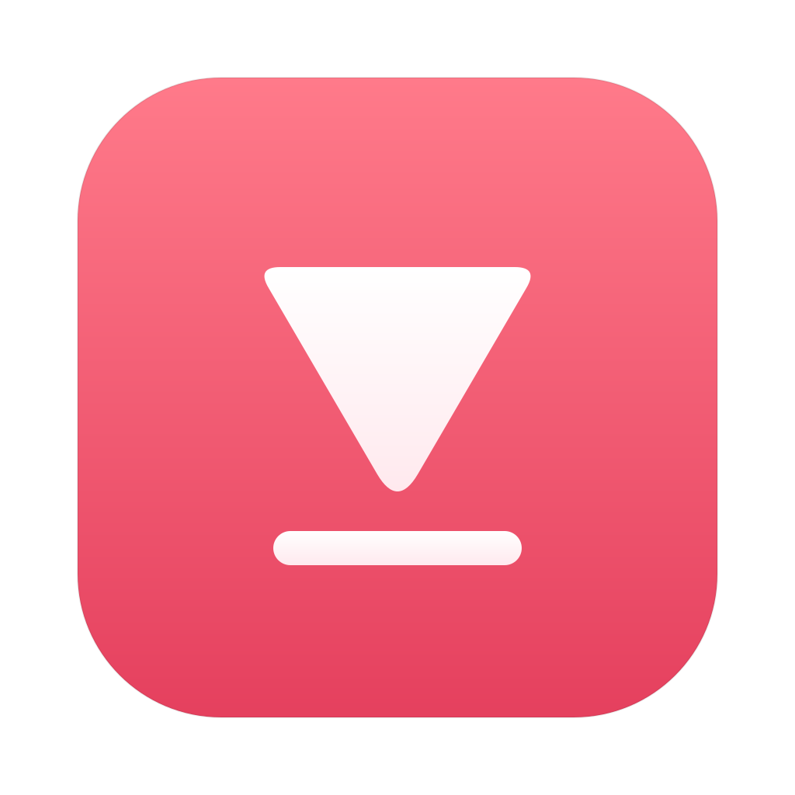
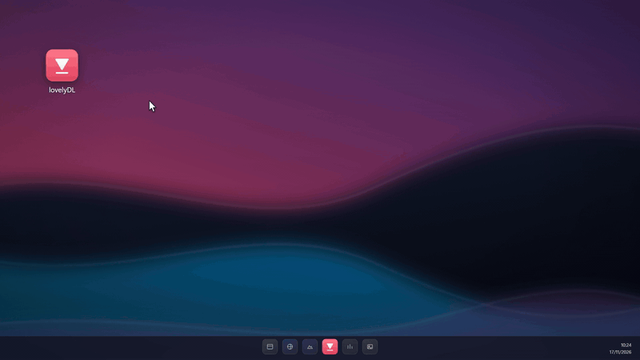
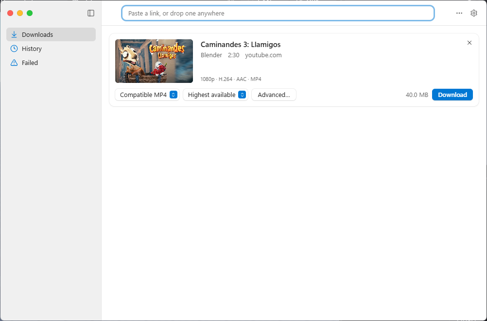
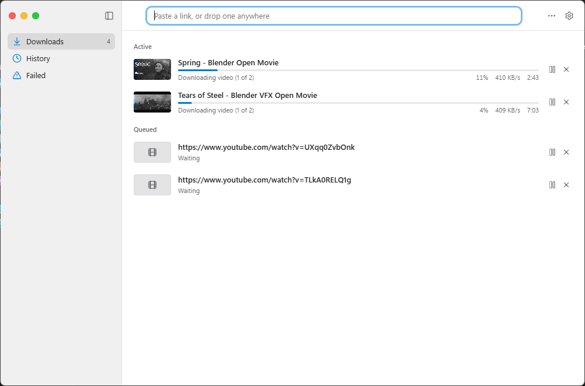
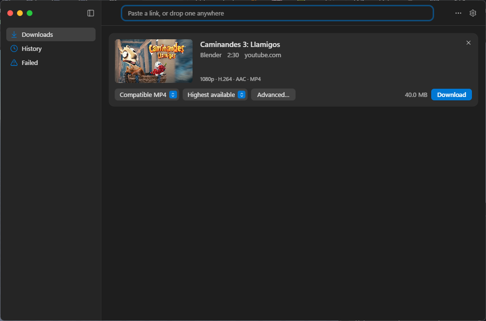
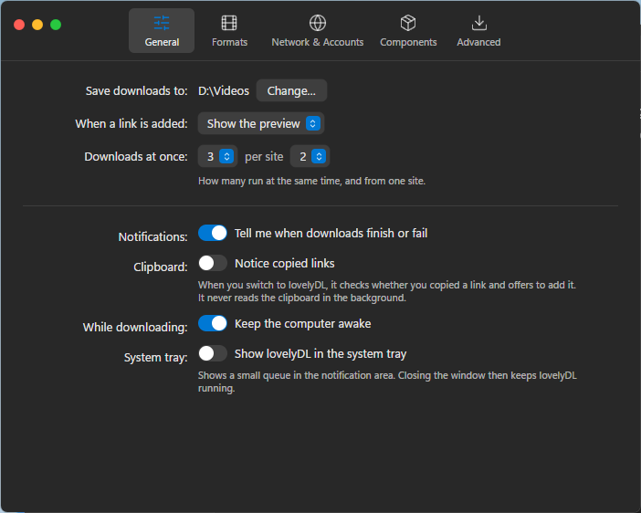

<p align="center"></p>

<h1 align="center">lovelyDL</h1>

<p align="center">
  <b>A calm, native-feeling video and audio downloader for Windows.</b><br>
  Free and open source. Paste a link, see what you will get, press Download.
</p>

<p align="center">
  <a href="https://github.com/FlyShip09/lovelyDL/actions/workflows/ci.yml"></a>
  
  
  
</p>

<p align="center">
  
</p>

<p align="center"><a href="docs/promo/lovelydl-ad.mp4">Watch the half-minute film</a></p>

lovelyDL is a desktop app (a GUI) for [yt-dlp](https://github.com/yt-dlp/yt-dlp), so it
works with the 1,000+ sites yt-dlp supports. It adds what a command line cannot: a preview
before anything is saved, a queue that survives restarts, presets that say what they
produce, playlists with a real selection sheet, and a history you can search. No account,
no ads, no telemetry.

<p align="center"></p>

**Download only what you have the right to save.** lovelyDL does not get around DRM or
paywalls, and it does not help anyone do so.

## Features

- **Add links any way**: paste anywhere in the window (Ctrl+V), type, drag a link from the
  browser, or open a `lovelydl://` link. Optionally, the app notices a link you just copied.
- **Preview first**: title, length, size and the exact resolution you will get, before
  anything is saved. Several links at once go straight to the queue with your default format.
- **Presets**: Best, Compatible MP4 (H.264 and AAC, which plays everywhere; on most sites
  that tops out at 1080p), resolution caps from 2160p to 480p,
  and audio as M4A, MP3, Opus or FLAC. An Advanced format picker lists every stream.
- **Queue**: 1–8 downloads at once (3 by default, 2 per site), pause, resume, cancel, retry,
  waiting downloads show their titles and thumbnails before their turn, and a download that
  drops out starts itself again,
  drag to reorder (or Alt+↑/↓), partial downloads that resume after a restart. A new
  download never replaces an older file with the same name; it gets a number.
- **Playlists and channels**: a selection sheet with search, select all or none, shift-click
  ranges, skip what you already have, their own folder and index numbers.
- **Options**: subtitles (embedded or as files), thumbnail, metadata and chapters,
  SponsorBlock, a time range, live streams, rate limit, proxy, and a file name template with
  a live preview.
- **History**: searchable, with Show in Explorer, Open, Copy link, Download again, and a
  mark on files that were moved or deleted.
- **Windows integration**: taskbar progress and badge, notifications, an optional tray icon
  with a mini queue, keep the PC awake while downloading, drag a finished file out of the
  window, light, dark and contrast themes, and Reduce Motion.
- **Tools managed for you**: yt-dlp, ffmpeg and Deno are downloaded from their official
  releases, checked against published SHA-256 sums, kept up to date, and can be rolled back.
  You can use copies already on your PC instead.

<p align="center"></p>

<p align="center"> </p>

## Install

Installers are published on the
[Releases](https://github.com/FlyShip09/lovelyDL/releases) page as
`lovelyDL_x.y.z_x64-setup.exe`. If no release is listed there yet, build it yourself with
the three commands under [Build from source](#build-from-source). The installer is for the
current user only and needs no administrator rights. It is built and tested on Windows 11;
Windows 10 should work but has not been tested. The setup installs WebView2 if it is missing.

Each release lists SHA-256 sums in `SHA2-256SUMS`. To check your download:

```powershell
Get-FileHash .\lovelyDL_0.1.0_x64-setup.exe -Algorithm SHA256
```

**"Windows protected your PC."** Until releases are code-signed, Microsoft Defender
SmartScreen shows this for new downloads. Click **More info**, check that the publisher and
file name are what you expect, then **Run anyway**. You see this once per version.

The first launch walks you through choosing a download folder and getting the tools.

## Bookmarklet

Add a bookmark with this address. Clicking it on a video page sends the page to lovelyDL,
which shows the preview and starts nothing on its own:

```
javascript:location.href='lovelydl://download?url='+encodeURIComponent(location.href)
```

Settings › Network & Accounts has a Copy button for it. A `lovelydl://` link can carry a link and a
preset, and nothing else: it can never set options, folders or custom arguments.

## Privacy

There is no telemetry, analytics, account, ads or remote configuration. The app makes
network requests only to:

| Destination | When |
|---|---|
| The sites you download from | When you add a link and download (through yt-dlp), and for thumbnails |
| `api.github.com`, `github.com`, GitHub's release-asset hosts | Checking for and downloading yt-dlp, ffmpeg (GyanD/codexffmpeg) and Deno; checking for lovelyDL updates |
| `sponsor.ajay.app` (SponsorBlock) | Only when SponsorBlock is turned on for a download |
| The proxy you set | For previews and downloads (yt-dlp) when you set one. Thumbnails, tool and app updates connect directly. |

Cookies: when you choose a browser in Settings › Network & Accounts, yt-dlp reads that
browser's cookies at download time. lovelyDL never copies, stores or logs them. Logs replace
your home folder with `~` and redact passwords, tokens and signed parameters in links.

Your data stays in `%APPDATA%\com.flyship09.lovelydl` (settings, history) and
`%LOCALAPPDATA%\com.flyship09.lovelydl` (tools, cache, logs).

## Build from source

You need Windows 10 or 11, [Rust](https://rustup.rs) (the version in
`rust-toolchain.toml` installs itself), Node.js 22 or later, and the WebView2 runtime.

```bash
npm ci
```

```bash
npx tauri dev
```

```bash
npx tauri build
```

The installer lands in `target/release/bundle/nsis/`. To work on the interface without the
Rust side, `npm run dev` serves it in a browser with mock data
(`http://localhost:5173/?scenario=busy`; see `ui/src/ipc/mock.ts` for the scenarios).

Checks, the same ones CI runs:

```bash
cargo fmt --all --check && cargo clippy --workspace --all-targets -- -D warnings && cargo test --workspace
```

```bash
npm run typecheck && npm run lint && npm test && npm run e2e
```

See [CONTRIBUTING.md](CONTRIBUTING.md) for more, [docs/ARCHITECTURE.md](docs/ARCHITECTURE.md)
for how it fits together, and [docs/RELEASING.md](docs/RELEASING.md) for releases and
signing.

## Support the project

If lovelyDL is useful to you, a star on GitHub helps other people find it. Bug reports with
the row's **Copy details** text are the most helpful thing you can send.

## License

lovelyDL is free software under the [GNU GPL, version 3 or later](LICENSE). It bundles no
third-party binaries; the tools it downloads keep their own licenses. See
[THIRD_PARTY_NOTICES.md](THIRD_PARTY_NOTICES.md).
